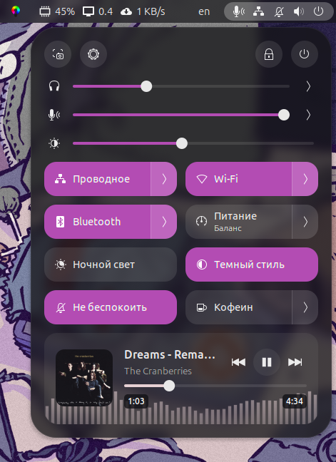

# Melody Island

A GNOME Shell 50 extension that adds music controls to the top bar and Quick Settings. It supports MPRIS players and uses CAVA to display an audio spectrum.

## Screenshots

**Top bar**


**Quick Settings**



## Features

- Play, pause, skip and seek with MPRIS-compatible players.
- Display track information, album art and playback progress.
- Show an audio spectrum in the player and optionally in the top bar.
- Match the spectrum and progress bar color to the album art, or choose a color manually.
- Use the top bar player, the Quick Settings player, or both.
- Adjust position, width, cover size and scrolling for long titles.

## Requirements

- GNOME Shell 50.
- An MPRIS-compatible player, such as Spotify or Rhythmbox.
- CAVA with PipeWire or PulseAudio support for the audio spectrum. Playback controls work without CAVA.
- `glib-compile-schemas` to install the extension settings.

On Ubuntu, install CAVA and the schema compiler with:

```bash
sudo apt update
sudo apt install cava libglib2.0-bin
```

## Installation

Install the extension with one command (requires `curl`):

```bash
bundle_dir=$(mktemp -d) && curl -fL 'https://github.com/Glebsolopdf/Melody-Island/raw/refs/heads/main/by@substitute.me.shell-extension.zip' -o "$bundle_dir/by@substitute.me.shell-extension.zip" && gnome-extensions install --force "$bundle_dir/by@substitute.me.shell-extension.zip" && gnome-extensions enable 'by@substitute.me'
```

If GNOME Shell has not detected the extension yet, log out and back in, then run `gnome-extensions enable 'by@substitute.me'`. Updating an already loaded extension on Wayland may also require logging out and back in.

To install from a local checkout, run `./install.sh` and enable the extension using the command above.

Start an MPRIS-compatible player to see the widget. By default, it is hidden when no player is running.

Open the extension settings from the **Extensions** application or run:

```bash
gnome-extensions prefs 'by@substitute.me'
```

The preferences contain separate sections for the top bar and Quick Settings. On Wayland, updating the extension's JavaScript may require logging out and back in before GNOME Shell loads the changes.

## Troubleshooting

- **The widget does not appear:** check that the extension is enabled and an MPRIS-compatible player is running.
- **The spectrum does not appear:** check that CAVA is installed and supports the active audio server. You can disable the spectrum in the extension settings.
- **The cover does not appear:** the image depends on the metadata supplied by the player and GNOME's access to its URL.

To inspect the extension and Shell logs:

```bash
gnome-extensions info 'by@substitute.me'
journalctl --user -b /usr/bin/gnome-shell | grep -iE 'melodybar|cava|mpris'
```

## Uninstallation

```bash
gnome-extensions disable 'by@substitute.me'
gnome-extensions uninstall 'by@substitute.me'
```

## Project structure

```text
by@substitute.me/
├── extension.js, prefs.js   # GNOME Shell entry points
├── metadata.json
├── stylesheet.css
├── schemas/                 # GSettings schema
└── src/
    ├── extension.js         # top bar and Quick Settings UI
    ├── panelPlayer.js       # player card
    ├── prefs.js             # preferences window
    ├── coverIcon.js         # artwork via Gio.FileIcon
    └── services/            # MPRIS, CAVA and artwork color
screenshots/
install.sh
```

By **substituteme**.
