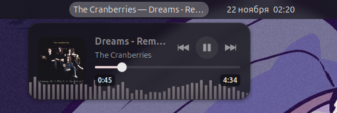

# Melody Island

A GNOME Shell 50 extension that adds music controls to the top bar and Quick Settings. It supports MPRIS players and uses CAVA to display an audio spectrum.

## Installation

Install the extension with one command (requires `curl`):

```bash
bundle_dir=$(mktemp -d) && curl -fL 'https://github.com/Glebsolopdf/Melody-Island/raw/refs/heads/main/by@substitute.me.shell-extension.zip' -o "$bundle_dir/by@substitute.me.shell-extension.zip" && gnome-extensions install --force "$bundle_dir/by@substitute.me.shell-extension.zip" && gnome-extensions enable 'by@substitute.me'
```

If GNOME Shell has not detected the extension yet, log out and back in, then run `gnome-extensions enable 'by@substitute.me'`. Updating an already loaded extension on Wayland may also require logging out and back in.

To install from a local checkout, run `sh ./install.sh` and enable the extension using the command above. To rebuild the ZIP with translations, run `gnome-extensions pack --extra-source=ui --extra-source=services --podir="$PWD/po" --force by@substitute.me`.

Start an MPRIS-compatible player to see the widget. By default, it is hidden when no player is running.

Open the extension settings from the **Extensions** application or run:

```bash
gnome-extensions prefs 'by@substitute.me'
```

The preferences contain separate sections for the top bar and Quick Settings. On Wayland, updating the extension's JavaScript may require logging out and back in before GNOME Shell loads the changes.

## Screenshots

**Top bar**



**Quick Settings**


## Features

- Play, pause, skip and seek with MPRIS-compatible players.
- Display track information, album art and playback progress.
- Read embedded artwork from a local audio file when the player does not supply a usable cover.
- Show an audio spectrum in the player and optionally in the top bar.
- Show synchronized lyrics from LRCLIB in the top bar player and Quick Settings. The Lyrics preferences control where lyrics appear, the intro notice, long-line scrolling and background opacity.
- Turn off lyrics globally in Lyrics preferences to stop requests to LRCLIB.
- Cache lyrics in memory for 10 minutes, with up to 32 entries. Missing results are cached for one minute.
- Space LRCLIB requests at least 1.5 seconds apart and honor server retry delays.
- Match the spectrum and progress bar color to the album art, or choose a color manually.
- Use the top bar player, the Quick Settings player, or both.
- Adjust position, width, cover size and scrolling for long titles.

## Requirements

- GNOME Shell 50.
- An MPRIS-compatible player, such as Spotify or Rhythmbox.
- CAVA with PipeWire or PulseAudio support for the audio spectrum. Playback controls work without CAVA.
- `glib-compile-schemas` to install the extension settings.
- GNU gettext (`msgfmt`) when installing from a source checkout.
- libsoup 3 GObject introspection bindings and internet access for LRCLIB.
- FFmpeg for embedded album art from local audio files.

On Ubuntu, install the dependencies with:

```bash
sudo apt update
sudo apt install cava ffmpeg libglib2.0-bin gir1.2-soup-3.0 gettext
```

## Troubleshooting

- **The widget does not appear:** check that the extension is enabled and an MPRIS-compatible player is running.
- **The spectrum does not appear:** check that CAVA is installed and supports the active audio server. You can disable the spectrum in the extension settings.
- **The cover does not appear:** check whether the player supplies an artwork URL or a local track URL with an embedded image.

To inspect the extension and Shell logs:

```bash
gnome-extensions info 'by@substitute.me'
journalctl --user -b /usr/bin/gnome-shell | grep -iE 'melodybar|cava|mpris'
```

## Uninstallation

```bash
gnome-extensions disable 'by@substitute.me'
gnome-extensions uninstall 'by@substitute.me'
```

## Project structure

```text
by@substitute.me/
├── extension.js             # GNOME Shell and playback integration
├── prefs.js                 # settings window
├── metadata.json
├── stylesheet.css
├── schemas/                 # GSettings schema
├── services/                # MPRIS, CAVA, artwork and LRCLIB
└── ui/                      # shared player card, lyric view and cover icon
screenshots/
po/                          # translations
install.sh
```

By **substituteme**.
